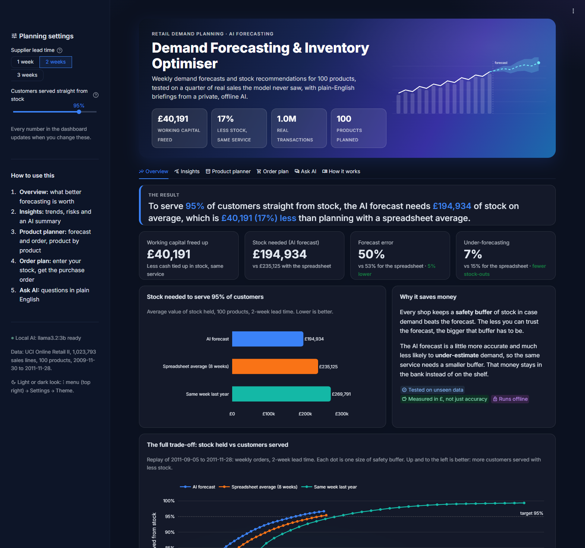
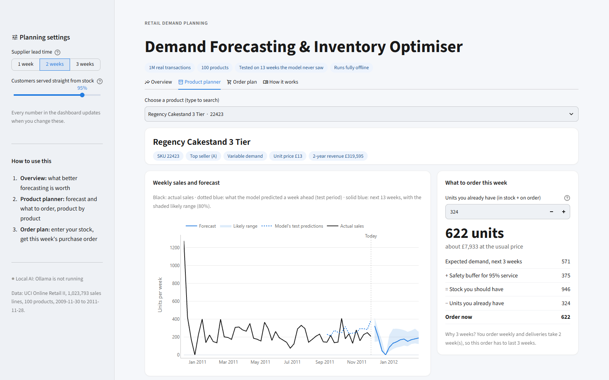
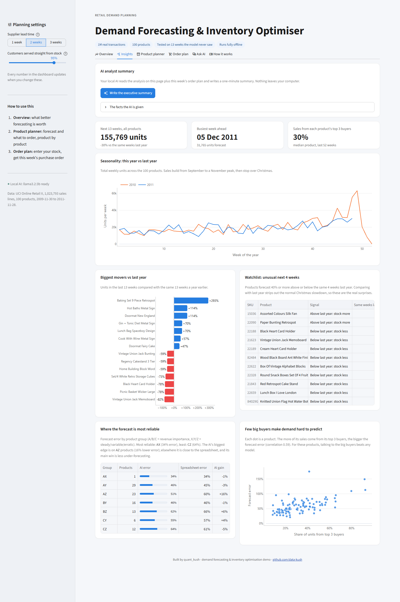

# Demand Forecasting & Inventory Optimiser

**Case study: an AI demand forecast that cuts the stock a retailer has to hold by 17% while serving customers just as well.**

A weekly demand-forecasting and replenishment tool for an online retailer, built on 1 million real
transactions. It forecasts demand per product, recommends how much stock to order, writes a
plain-English briefing for each product with a free local AI model, and shows in money what the better
forecast is worth.



## Results (13 weeks of unseen data, Sep–Nov 2011)

| Forecasting method | Forecast error (WAPE, 1–4 weeks ahead) | Bias | Avg. stock needed for 95% fill rate* |
|---|---|---|---|
| **LightGBM (AI model)** | **50.4%** | **−6.6%** | **£194,934** |
| 8-week moving average (typical spreadsheet) | 52.9% | −15.4% | £235,125 |
| Same week last year, trend-adjusted | 80.4% | +24.0% | £269,791 |

\*100 products, weekly ordering, 2-week supplier lead time, safety stock sized on the quarter *before* the test period.

**At the same 95% service level, the AI forecast needs £40,191 (17.1%) less stock on average than the
moving average.** That money is working capital the business gets back. The headline accuracy gain
looks small (4.8% lower error), but the AI model is much less biased and its errors are more
predictable, so it needs far less safety stock. That's where the savings come from.

> The raw error is high for every method because weekly demand per product is very lumpy here: this
> retailer sells largely to wholesale buyers, so one customer can order hundreds of units in a single
> week. That's why judging forecasts by their inventory outcome matters more than accuracy alone.

## What the dashboard does

| Tab | What a client sees |
|---|---|
| **Overview** | The result in one sentence, working capital freed up, stock needed by each method, and the full stock vs. service trade-off |
| **Insights** | AI executive summary, 13-week outlook, seasonality this year vs last, biggest movers, a watchlist of products unusually above/below last year, accuracy by product group, and how dependence on a few big buyers drives forecast error |
| **Product planner** | A year of sales, the model's test predictions, a 13-week forecast with likely range, a step-by-step "what to order" calculation, and an AI briefing |
| **Order plan** | Type in current stock and get this week's purchase order for all 100 products (CSV), plus an AI-drafted supplier email you can edit |
| **Ask AI** | Chat with the data: questions about demand, risks, the order or any named product, answered from the dashboard's own numbers |
| **How it works** | Method, testing approach and what the model pays most attention to |

**Key findings from the analysis**
- The AI's biggest edge is on **erratic top sellers (AZ)**: 16% lower error than the spreadsheet. On steadier products it is about level, and the money comes from it under-forecasting much less.
- **Buyer concentration explains forecast error** (correlation 0.59). The median product gets 30% of its units from just 3 buyers, and some get over 90%. For those products, talking to the big buyers beats any model.
- Last December's sales were inflated by one-off bulk orders, which the model doesn't expect to repeat. That's why the next 13 weeks are forecast 30% below last year, led by products like card holders that sold thousands of units to a few buyers.

Lead time (1–3 weeks) and the share of customers served from stock (80–99%) are adjustable, and every number updates.





## Method

1. **Data:** [UCI Online Retail II](https://archive.ics.uci.edu/dataset/502/online+retail+ii) from a UK gift
   retailer, Dec 2009 to Dec 2011. Cancellations and the orders they cancel, returns, postage, fees and
   manual adjustments are removed. The 100 highest-revenue products that sell in at least 70% of weeks
   become a weekly demand panel (105 weeks).
2. **Models:**
   - One global LightGBM model across all products. Features: lags 1–52 weeks, rolling means and
     volatility, share of zero-sales weeks, year-on-year change, week of year, and Christmas
     wind-down/closure flags. It forecasts recursively, and quantile models give the 80% range.
   - Two baselines a business would actually use: an 8-week moving average, and same week last year
     adjusted for trend.
3. **Honest backtest:** every week of the 13-week holdout, each method forecasts 1–4 weeks ahead using
   only data before that week (rolling origin). The models are trained before the holdout starts.
4. **Inventory replay:** a weekly order-up-to policy. Target = forecast demand over lead time + 1 week,
   plus z × the forecast error measured on the *previous* quarter. Orders arrive after the lead time, real
   demand is served, and unmet demand is lost. Sweeping the safety factor traces fill rate against
   average stock value for each method.
5. **Local AI (Ollama, `llama3.2:3b` by default):** writes product briefings, an executive summary and
   supplier emails, and answers questions in the Ask AI tab. It runs free and offline on a normal laptop
   CPU (20–60 seconds per answer). Every prompt is grounded in a compact fact sheet the app computes, the
   model is told never to invent numbers, and the facts it was given are always one click away. If
   Ollama isn't running, the rest of the app still works.

## Run it locally

```powershell
python -m venv .venv
.venv\Scripts\pip install -r requirements.txt
# download the dataset zip from the UCI link above and unzip online_retail_II.xlsx into data\raw\
.venv\Scripts\python -m src.pipeline        # about 1 minute after the first Excel load
.venv\Scripts\streamlit run app.py
```

Optional, for the AI briefings: install [Ollama](https://ollama.com), then run `ollama pull llama3.2:3b`.
To use another local model, set `OLLAMA_MODEL`.

## Project layout

```
src/data_prep.py     cleaning, weekly panel, ABC/XYZ classification
src/forecasting.py   features, LightGBM + baselines, rolling-origin backtest, accuracy
src/inventory.py     safety stock, order-up-to policy, inventory replay
src/insights.py      local-LLM briefings (Ollama) with fallback
src/pipeline.py      runs everything and saves results to artifacts/
app.py               Streamlit dashboard
```

## Using this for a client

Swap in the client's order history (date, product, quantity, price) and their supplier lead times. The
same pipeline produces their accuracy, safety stock and working-capital numbers.
